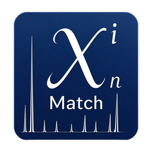

<div align="center">
  
</div>

简体中文 · [English](README.md)

# XinMatch

开源的**粉末 X 射线衍射（XRPD）物相分析**平台——一个洁净室（clean-room）实现，遵循公开文档化的 XRD 物相分析流程、已发表的算法以及开放的参考数据（COD）。

> ✅ **v3.6.3.** 核心计算内核 + 完整 GUI + 双模式检索-匹配（峰列表 FoM / FPFM 全谱拟合（Full Pattern Fitting Match，前称 SMPF））+ **序贯多物相鉴定**（确认一个物相 → 在剩余未解释峰上重新检索 → 确认下一个）+ 真正的 March-Dollase 择优取向建模 + GSAS-II 精修流程 + 定量 Rietveld（在认证样品上主相 wt% 误差 < 3）均已完工并打包（Windows 安装包 / 便携版）。v3.2.0 新增**物相级身份**（`core/search/phase_key.py`）：候选列表将描述同一物相的卡片折叠为一行（可展开，每张卡片的晶胞悬停即见），基准测试按条目与按物相双重计分——同一个库，物相级 Top-1 由 7/13 提升至 **10/13**，原因只是"在兄弟卡片上找到了正确的物相"不再被计为失误。本版还更新了 logo/图标集并重新生成了启动画面。
> v3.3.0 在残差候选列表中新增**稀疏物相标记**：一张卡片的最强参考峰位于一条较强的剩余峰上、位置准确且自身反射自洽时，会被标注 `★`（FoM 计的是候选"解释了多少条峰"，所以 6 条峰的金属永远会被 150 条反射的卡片压过）。该标记仅作提示——排名不变，因为同样的规则在真实数据上也会标出错误物相（见 `docs/基准报告-物相检索-v3.md` §11.5）。
> v3.4.0 新增**物相分析导出**（`文件 → 导出物相分析（.xinm）…`）：锚定谱图、所选物相的 COD CIF 及其元数据被打包成一个自包含的 zip，由姊妹项目 [XinRefinement](../XinRefinement) 一键导入，即可启动全谱拟合精修——无需重新导入谱图，也无需在 522 K 个文件的 COD 档案里翻找 CIF。格式契约：`docs/JOINT_PLAN_xinm_xinr.md`。
> v3.0.0 用单一的 **v3 列式 `.xinDB`** 布局替换了最后几种遗留参考格式，并内置 **COD-Inorg** 库作为默认库：
>
> * 默认库 = `COD-Inorg-<snapshot>.xinDB`，随便携版打包于 `data/` → **开箱即用**，无需单独下载；
> * 单一读取器、单一检索路径（`search_match_v3`）；v2 SQLite（`cod_inorganics.db`）、PolyXRD-dump 与 PDF-2 读取器已被**删除**，而非弃用；
> * 仍可从任意文件夹挂载（设置→参考数据库…，或 `xinmatch libraries --add <path>`），仅限 `.xinDB`。
>
> **v3.6.3** 把元素限定改成**四态 + 闭环**（口径对齐姊妹项目 PolyXRD，接口只增不改）：
> ① 元素状态由「必含 / 排除 / 不限制」扩为「**必有**」（AND）、「**含有**」（OR，至少含一个）、
> 「**可能**」（只放宽允许池）、「**没有**」+ 不限制，点击顺序把过滤最狠的「必有」放末位；
> ② 新增**闭环开关**「限定在所选元素内」——未标状态的元素一律视为「没有」，
> 于是「只允许样品里检出的这几个元素」不必再点 113 个按钮；③ 预筛新增 `elements_any`
> 通路（原来只有「必须全含」与「含任一即淘汰」），四态的换算收敛到 `element_constraint_sets()`
> 一处；④ 面板加「补轻元素」一键把 O/C/H/N/S 标为「含有」。旧存档、旧用法行为逐位不变
> （闭环默认关闭），基准数字不动。
> ⑤ **物相鉴定默认改用 FPFM 全谱拟合（不寻峰）**，下拉框仍可一键切回「峰列表 FoM（寻峰）」。
> ⚠️ 注意：FPFM 检索链不接受元素限制条件，**要用元素限定请切回峰列表 FoM**；
> 工具栏「样品元素」按钮在有约束 + FPFM 时会常显「｜FPFM 下不生效」提示。
> **下载**：[GitHub Release v3.6.3](https://github.com/PolyXRD/XinMatch/releases/tag/v3.6.3)
> （Windows 安装包，内置 COD-Inorg 默认库，开箱即可检索）；详见
> [docs/RELEASE-NOTES-v3.6.3.md](docs/RELEASE-NOTES-v3.6.3.md)。
>
> **v3.6.2** 改的是谱图区交互（接口与数据格式均无变更）：
> ① 谱图下方新增**参考线分区**——候选列表高亮哪个相，就在谱图正下方画出它的峰位
> 与强度（一行一相、左标化学式、横坐标与谱图联动对齐），已确认的相也全部列进去，
> 一眼看出「哪些峰还没被任何相匹配」；勾选框可切「只看角度位置 / 同时看强度」；
> ② 顶部「X 轴 / Y 轴 / 适应数据范围」控制条隐藏但功能保留，切换到**点击坐标轴**上
> （左键循环、右键菜单）；③ 谱图上方加了一排**快捷图标**（复位 / 横向框选 / 纵向框选 /
> 区域放大 / 左右平移 / 步进缩放 / 十字线），参考姊妹项目 XinRefinement 的实现移植。
> 详见 [docs/RELEASE-NOTES-v3.6.2.md](docs/RELEASE-NOTES-v3.6.2.md)。
>
> **v3.6.1** 是纯缺陷修复版，修三处实测报障，接口与数据格式均无变更：
> ① 谱图图例每条曲线**出现两次**（pyqtgraph 的 `PlotItem.addItem()` 已自动加图例，
> 代码又手动加了一次 —— 曲线一直只有 1 条，重复的是图例行）；
> ② Rietveld 精修向导**整窗白屏 + 卡死**（精修在 GUI 线程同步跑 GSAS-II 子进程
> 导致「(未响应)」，同时「开始精修」按钮会滑到「下一步」的位置，连点就误触），
> 现改为后台线程 + 动作按钮移入页面内部；③ 列表「晶系」列把**六方相标成单斜**
> （只按「非 90° 角个数」判据，而六方唯一的非直角就是 γ=120°），已补 `H`/`R` 判据。
> 详见 [docs/RELEASE-NOTES-v3.6.1.md](docs/RELEASE-NOTES-v3.6.1.md)。
>
> **v3.6.0** 补的是「能点但没反应」：15 个功能模块里有 11 个菜单动作只在状态栏
> 播一句「模块骨架已就位」，而 `core.quant` / `core.micro` / `core.index` 早已
> 完成。现在它们全部接上真实对话框 —— Profile Fitting（F5，谱形四选一 + Rwp +
> 曲线叠加）、RIR 定量（绝热法，wt% 写回匹配列表）、Scherrer / Williamson-Hall
> 微结构（D / ε / R²）、Treor90 / DicVol06 指标化（候选单胞表）、数据导出聚合
> 菜单（谱图 ASCII + 三张表 CSV + `.xinm` + CIF）。顺带：候选列表默认显示
> 50 行（族级覆盖 81/98 → **89/98**，计算成本为零）；峰位精修换 LM，
> 207 峰预处理 **35.2 s → 0.35 s**、CLI 端到端 **36 s → 2.3 s**；元素周期表
> 重做尺寸与三态编码（不再被全局 QSS 裁字）。检索默认行为逐项不变；详见
> [docs/RELEASE-NOTES-v3.6.0.md](docs/RELEASE-NOTES-v3.6.0.md)。
>
> 完整实现计划见 [docs/ROADMAP_v3.md](docs/ROADMAP_v3.md)，当前进度见 [docs/STATUS.md](docs/STATUS.md)。

## XinMatch 能做什么

- **定性物相分析**（检索-匹配）：根据实验粉末衍射谱图，对照参考数据库鉴定晶态物相。
- **序贯多物相鉴定**（v3.1.0）：确认最佳物相，扣除其解释的部分，在**剩余未解释峰**上重新检索下一个物相——重复直至无显著峰残留。每次确认都可撤销，残差状态（已解释 / 残留 / 过弱无法使用）显示在候选列表旁边。
- **物相级候选列表**（v3.2.0）：一个参考库每个物相有数十张卡片，过去近似条目会淹没 Top-N。现在卡片按物相折叠为一行（晶胞 / 元素集合 / 空间群相同，见 `core/search/phase_key.py`）；"变体"列显示折叠了多少张卡片，其悬停提示逐张列出卡片及其晶胞，右键菜单可再次展开。
- **稀疏物相标记**（v3.3.0）：残差检索会标记出最强参考峰落在较强剩余峰上的候选（`★` 在第一列，规则见 `core/search/sequential.py`）。FoM 计的是候选"解释了多少条峰"，所以正确的 6 条峰金属永远压不过 150 条反射的卡片；该标记在不改变排序的前提下让其可见。
- **定量物相分析**（RIR、内标法、Rietveld）。
- **原始数据预处理**：平滑、背景扣除、Kα₂ 剥离、零点 / 位移校正。
- **谱形拟合与寻峰**。
- **Rietveld / Le Bail 精修**（委托 GSAS-II 完成）。
- **粉末指标化**（Treor / Dicvol）。
- **微结构**：晶粒度（Scherrer）、微应变、结晶度。
- **报告与导出**、**GUI**（PySide6）、**CLI / 批处理脚本**。
- **参考数据库挂载**：除内置的 `COD-Inorg` 库外，任何其他 `.xinDB` 库都可从**任意文件夹**挂载（设置→参考数据库…，或 `xinmatch libraries --add <path>`）。v3 库是独立的列式文件，因此不会复制或转换任何内容。
- **3COD 库按来源拆分**（`tools/split_3cod.py`）：`COD-Inorg`（实验，7.9 万）、`PCOD-Inorg`（预测，106 万）、`TCOD-Inorg`（理论，4.7 万）。三者可在 XinMatch 中并排挂载；PolyXRD 只会取用实验库，因为另外两个不含 `phases` 表。详见 [docs/ACCEPTANCE-3COD-20261020.md §6](docs/ACCEPTANCE-3COD-20261020.md)。
- **参考库在姊妹仓库构建，而非本仓库。** `XinMatch-DataBase` 构建全部六个库（`COD` / `PCOD` / `TCOD` × `Inorg` / `Full`）；CIF 源文件位于上一级目录 `../sync-COD`（可用 `XRD_DATA_ROOT` 覆盖），构建出的 `.xinDB` 文件默认位于 `XinMatch-DataBase/data/`。构建 / 校验 / 验收命令见该仓库的 [`docs/构建与验收手册.md`](../XinMatch-DataBase/docs/构建与验收手册.md)。

## 设计原则

1. **洁净室**：不对专有软件进行反汇编或反编译。规范来自官方文档 + 已发表算法 + 为互操作而做的黑盒文件格式观察。
2. **内核 / GUI 解耦**：`xinmatch/core/` 内的一切都是纯计算（numpy 数组 + dataclasses），无需显示器即可做单元测试。`xinmatch/ui/` 中的 GUI 只是其上的一层薄封装。
3. **开放数据优先**：参考数据库由 [COD](https://www.crystallography.net/cod/)（CC0）公开数据转储构建。
4. **小而可验证的步骤**：每个任务都附带 pytest 验收标准，以便 AI 智能体可独立地构建、测试与调试。

## 项目结构

```
xinmatch/
├── core/            # 纯计算内核（无 GUI）
│   ├── model/       # Pattern、Peak、Entry、Phase、Restraints、Project
│   ├── io/          # 33 种衍射格式 + CIF + 导出器
│   ├── preprocess/  # 平滑、背景、Kα2、零点，……
│   ├── peak/        # 寻峰、谱形拟合、峰形
│   ├── db/          # SQLite 参考数据库（COD）+ 用户数据库
│   ├── search/      # FoM 检索-匹配、PFSM、约束
│   ├── index/       # Treor / Dicvol 指标化
│   ├── refine/      # Le Bail / Rietveld（委托 GSAS-II）
│   ├── quant/       # RIR、内标法、Rietveld 定量
│   ├── micro/       # 晶粒度、微应变、DOC
│   └── report/      # 报告数据模型 + 渲染
├── ui/              # PySide6 GUI
├── cli/             # 命令行 / 批处理接口
├── utils/           # 注册 + 构建变体（仅标准库，无 Qt）
tests/               # pytest 套件 + 夹具 + 参考基线
docs/                # 分析文档（参考帮助保留在外部）
tools/               # 辅助脚本（文档抽取、基线构建）
```

## 快速开始

```powershell
# （可选）创建虚拟环境
python -m venv .venv
.venv\Scripts\Activate.ps1

# 以可编辑模式安装，含 dev + gui 附加组件
pip install -e ".[dev,gui]"

# 运行测试套件（快速子集；默认排除 ``slow`` 标记）
pytest

# 包含数值计算较重的套件（开启最小二乘、GSAS-II 子进程、
# L3 验收 curve_fit）——耗时数十分钟
pytest -m slow

# 完整本地 CI（ruff + mypy + 测试），对应 .github/workflows/ci.yml
powershell -File tools/ci.ps1
```

> 参考库（`*.xinDB`，约 110 MB–1.7 GB）不在仓库中；源码检出时从 `../XinMatch-DataBase/data` 解析（`XINMATCH_XINDB_DIR` 可覆盖）。需要它们的测试会自动跳过自身。

### 免打包直接运行（直接运行工作树源码）

`run_dev.bat` 原地启动工作树中的代码——无需 PyInstaller 构建、无需安装步骤，因此你看到的始终是最新源码。不带参数时打开 GUI；其他参数均转发给 CLI（`python -m xinmatch.cli.main`）：

```bat
run_dev.bat                                  :: GUI
run_dev.bat search pat.txt --db ..\XinMatch-DataBase\data\COD-Inorg-20261020.xinDB --top-n 5 --json
run_dev.bat libraries --json                 :: 列出可用的 .xinDB 库
```

解释器按以下顺序解析，并在启动时回显：`%XINMATCH_DEV_PYTHON%` → `.venv\Scripts\python.exe` → `venv\Scripts\python.exe` → `D:\Project\XRD\python310\python.exe` → `PATH` 上的 `python`。因为批处理文件会 `cd` 到仓库根目录，所以即使 site-packages 中装了另一份副本，`python -m` 也会加载本地的 `xinmatch/` 包。

## 构建版本与注册

v1.7.0 起同时产出两个二进制。**v3.0.0 起两个版本都内置默认库** `COD-Inorg-<snapshot>.xinDB`
（解压/安装即可检索；位置 `<程序目录>\data\`，可自行替换或再挂载其他 `.xinDB`）：

| 构建 | 产物 | 注册机制 | 状态栏最右端 |
|---|---|---|---|
| **正式版**（release） | `XinMatch-Setup-<v>.exe`（安装时可选择安装位置） | **有**：每次启动检查注册状态 | `已注册：<单位部门名称>` / `未注册` |
| **内部评估版**（internal） | `XinMatch-Internal-<v>.zip`（免安装，自用） | **无** | **红色加粗** `内部评估版本` |

**v3.4.0 发布产物**：

| 附件 | 体积 | SHA-256（前 16 位） |
|---|---|---|
| `XinMatch-Setup-3.4.0.exe`（正式版安装包，内置 COD-Inorg 库） | 242.4 MiB | `4962defa7d0e4cf7…` |
| `XinMatch-Internal-3.4.0.zip`（便携包 = 内部评估版，红字标识，内置 COD-Inorg 库） | 351.4 MiB | `fb82ce897bf4227a…` |
| `SHA256SUMS.txt` | — | — |

参考库本版未变更，两个二进制均内置 `COD-Inorg-20261020.xinDB`（重建版，78,035 相）。
`.xinm` 导出需与 **XinRefinement 1.1.0** 配套使用。
更大的外挂库（`PCOD` / `TCOD` / `Full` / Materials Project）在姊妹仓库
[XinMatch-DataBase Releases](https://github.com/PolyXRD/XinMatch-DataBase/releases) 分发：
下载 `*.xinDB.zip` → 解压 → **「设置 → 参考数据库…」** 或
`XinMatch.exe libraries --add <path>` 挂载，可多库并存；详见
`docs/RELEASE-NOTES-v3.4.0.md` §七。

正式版未注册时，每次启动弹出提示：

> 本软件未注册，版权所有，禁止用于商业用途。
> 如需注册请联系 <CONTACT_REDACTED>

点「**确定**」关闭提示、软件照常使用（下次启动仍会提示）；点「**输入注册码**」粘贴注册码，
校验通过后即完成注册，此后不再提示。也可随时通过 **帮助 → 输入注册码(&R)…** 注册。

注册码由开发方根据用户提供的「单位部门名称」生成：`PXRD1-XXXX-XXXX-…`（Base32 载荷
`UTF8(单位名) + HMAC-SHA256[:8]`），软件端重新校验并可还原单位名用于状态栏展示；
无需联网、无需机器码，同一单位可在多台电脑使用。算法与 PolyXRD 家族统一
（复用 `D:\Project\XRD\PolyXRD-Reg`，本仓副本 `xinmatch/utils/registration.py`）。

## 授权许可

本软件采用**双许可**模式（学术许可 + 商业许可），与上游 PolyXRD 项目一致。
本软件采用**双许可**（学术许可 + 商业许可）发布，与上游 PolyXRD 项目一致。

- **英文（English）**：[LICENSE](LICENSE)
- **中文（简体）**：[LICENSE-CN](LICENSE-CN)

学术用途可依据【学术许可】免费使用；任何商业用途须事先联系版权持有人取得独立书面【商业授权】（详见许可证正文）。
学术用途依据学术许可免费使用；任何商业用途须事先取得版权持有者的独立书面商业许可（见许可证正文）。
